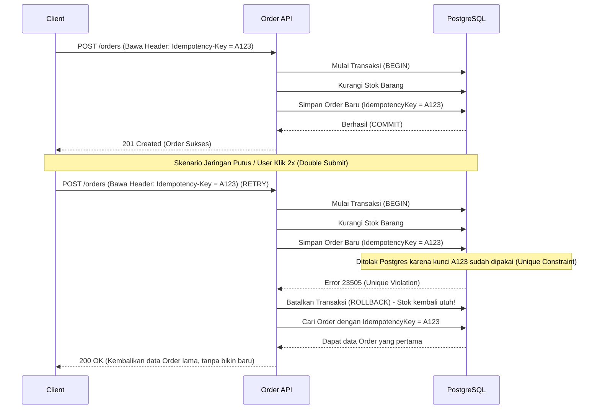

# Order Management API

REST API untuk sistem manajemen pesanan (Order Management). Dibangun menggunakan **.NET 10**, **ASP.NET Core**, **Entity Framework Core**, dan **PostgreSQL**.

Proyek ini mendemonstrasikan teknik lanjutan seperti penanganan bentrok data (*concurrency handling*), pencegahan pesanan ganda (*idempotency*), pencatatan log terstruktur (*structured logging*), dan arsitektur kode yang sangat rapi (Clean/N Layered Architecture).

---

## 🛠️ Tech Stack

| Layer | Teknologi |
|-------|-----------|
| Runtime | .NET 10 / ASP.NET Core |
| ORM | Entity Framework Core 9 + Npgsql |
| Database | PostgreSQL 16 |
| Logging | Serilog (Tampil di Console + Simpan ke File log) |
| UI API Docs | Scalar (Bisa diakses langsung di `/scalar/v1`) |
| Testing | xUnit + Testcontainers + FluentAssertions + Moq |

---

## 🏗️ Arsitektur

Menggunakan arsitektur *Clean/N Layered* yang secara tegas dipisah menjadi 4 *project*:

```
OrderManagement.Model        → Entitas utama, DTO, interface, dan aturan status (state machine)
OrderManagement.Repository   → Koneksi ke DB (EF Core), migrasi, dan implementasi repository
OrderManagement.Services     → Tempat semua logika dan aturan bisnis berada (OrderService)
OrderManagement.API          → Menangani rute API (Controllers), middleware, dan setting awal
OrderManagement.Tests        → Tempat unit test dan integration test
```

---

## 🚀 Cara Menjalankan

### Persyaratan
- SDK .NET 10
- PostgreSQL 16 (atau Docker kalau mau menjalankan Testcontainers untuk proses *testing*)

### Konfigurasi Database
Cek file `appsettings.json` di dalam folder `OrderManagement.API`. Pastikan `ConnectionStrings` sudah sesuai dengan kredensial database lokal Anda:
```json
{
  "ConnectionStrings": {
    "DefaultConnection": "Host=localhost;Port=5432;Database=order_management_api;Username=postgres;Password=rahasia"
  }
}
```

### Jalankan API
```bash
cd OrderManagement.API
dotnet run
```
*Tenang saja, pembuatan tabel di database (EF Core migrations) akan tereksekusi **otomatis saat aplikasi pertama kali menyala**.*

**Test API-nya:**
Buka browser dan kunjungi `https://localhost:<port>/scalar/v1` untuk mencoba API lewat UI dokumentasi dari Scalar.

### Jalankan Testing
```bash
dotnet test
```
*Catatan: Integration test membutuhkan **Testcontainers**, jadi pastikan aplikasi Docker Desktop Anda sedang menyala saat menjalankan test.*

---

## 📡 Daftar Endpoint API

| Method | Endpoint | Deskripsi | Syarat Khusus |
|--------|----------|-------------|------|
| `POST` | `/api/orders` | Bikin order baru | Wajib pasang Header `Idempotency-Key` |
| `GET` | `/api/orders/{id}` | Lihat detail sebuah order | — |
| `GET` | `/api/orders` | Tarik semua order (bisa difilter & paging) | — |
| `PATCH` | `/api/orders/{id}/status` | Ubah status order | — |
| `POST` | `/api/orders/{id}/cancel` | Batalkan order | — |

### Persiapan Data (Dummy Data)

Sebelum mengetes API *Create Order*, silakan eksekusi *query* SQL berikut di PostgreSQL Anda untuk memasukkan produk contoh:

```sql
INSERT INTO products (id, name, price, stock_quantity)
VALUES 
    ('11111111-1111-1111-1111-111111111111', 'Laptop ASUS ROG', 15000000.00, 10),
    ('22222222-2222-2222-2222-222222222222', 'Mechanical Keyboard Keychron', 1500000.00, 50),
    ('33333333-3333-3333-3333-333333333333', 'Wireless Mouse Logitech', 500000.00, 100);
```

### Contoh Request API (cURL)

Berikut adalah perintah `curl` lengkap untuk menguji masing-masing endpoint secara manual. *(Catatan: Ganti `https://localhost:7115` dengan port yang aktif di PC Anda, dan ganti `{ORDER_ID}` dengan ID pesanan yang sesungguhnya).*

**1. Create Order (POST)**
```bash
curl -X POST "https://localhost:7115/api/orders" \
  -H "Idempotency-Key: f47ac10b-58cc-4372-a567-0e02b2c3d479" \
  -H "Content-Type: application/json" \
  -d '{
    "customerId": "99999999-9999-9999-9999-999999999999",
    "shippingAddress": "Jl. Kemerdekaan No. 45, Jakarta Pusat",
    "items": [
      {
        "productId": "11111111-1111-1111-1111-111111111111",
        "quantity": 1
      },
      {
        "productId": "22222222-2222-2222-2222-222222222222",
        "quantity": 2
      }
    ]
  }'
```

**2. Get Order by ID (GET)**
```bash
curl -X GET "https://localhost:7115/api/orders/{ORDER_ID}" \
  -H "Accept: application/json"
```

**3. List Orders & Pagination (GET)**
```bash
curl -X GET "https://localhost:7115/api/orders?status=Pending&page=1&pageSize=10" \
  -H "Accept: application/json"
```

**4. Update Order Status (PATCH)**
*(Aturan Status: `1` = Confirmed, `2` = Shipped, `3` = Delivered)*
```bash
curl -X PATCH "https://localhost:7115/api/orders/{ORDER_ID}/status" \
  -H "Content-Type: application/json" \
  -d '{
    "status": 1
  }'
```

**5. Cancel Order (POST)**
*(Stok barang otomatis akan dikembalikan ke gudang jika berhasil).*
```bash
curl -X POST "https://localhost:7115/api/orders/{ORDER_ID}/cancel" \
  -H "Accept: application/json"
```

---

## 🚦 Alur Status Pesanan (State Machine)

```
[*] ──► Pending ──► Confirmed ──► Shipped ──► Delivered ──► [*]
                  ↘           ↘
                   Cancelled   Cancelled
```

| Status Awal | Boleh Berubah Menjadi... |
|-------------|-------------------------|
| `Pending`   | `Confirmed`, `Cancelled` |
| `Confirmed` | `Shipped`, `Cancelled`   |
| `Shipped`   | `Delivered`             |
| `Delivered` | *(sudah final, tidak bisa diubah)* |
| `Cancelled` | *(sudah final, tidak bisa diubah)* |

---

## 🐘 Kenapa Pilih PostgreSQL?

1. **Native row-level locking** — Mampu mengunci baris data dengan sangat cepat (`UPDATE WHERE`), jadi kita bisa mengurangi stok dengan aman tanpa ribet bikin sistem lock manual.
2. **Kolom Sakti `xmin`** — Kolom bawaan Postgres yang otomatis ganti angka setiap kali ada *update*. Sangat cocok dipakai sebagai pendeteksi bentrok (*Optimistic Concurrency*) secara gratis tanpa menuh-menuhin tabel.
3. **`UNIQUE INDEX`** — Pelindung utama kita untuk menolak secara paksa jika *user* melakukan pesanan dobel (*idempotency*).

---

## 1. Idempotency Strategy (Mencegah Order Dobel)

**Pendekatan: Wajib pakai Header `Idempotency-Key` (UUID dari Client)**

**Kenapa pilih ini?**
Di aplikasi *e-commerce* atau sistem pemesanan, masalah paling menakutkan adalah **transaksi ganda** akibat koneksi internet yang jelek. 
Bayangkan *user* sudah klik "Beli", *server* sudah memotong stok, tapi koneksi *user* putus sebelum dapat respons sukses. *User* biasanya panik dan menekan tombol "Beli" lagi (atau dari aplikasinya melakukan *auto-retry*). Kalau tidak diantisipasi, pesanan dan potongan stoknya bisa dobel!

Nah, dengan mewajibkan header `Idempotency-Key` di API, kita bisa mengamankan transaksi agar cuma diproses satu kali saja (*Exactly-Once*). 
Kalau *client* mengirim request ulang dengan kunci yang sama akibat nyangkut, *server* bakal langsung sadar: *"Oh, ini transaksi yang tadi"* dan cuma mengembalikan respons sukses yang pertama tanpa memotong stok lagi. Cara ini dipakai standar oleh API kelas dunia seperti Stripe dan layanan perbankan.

**Justifikasi Pilihan (Kenapa pakai Header UUID + Postgres Unique Constraint?)**
Saat mendesain fitur *idempotency*, ada 3 opsi yang biasa dipakai di industri. Berikut adalah alasan saya memilih pendekatan ini:

| Alternatif Pendekatan | Kelebihan | Kekurangan / Risiko | Justifikasi |
|-----------------------|-----------|---------------------|-------------|
| **1. Header UUID + DB Unique Constraint (Pilihan Kita)** ✅ | Sangat tangguh (*race-condition proof*) karena dikawal langsung oleh *database constraint*, tidak butuh *server* tambahan. | *Client* (Frontend/Mobile) harus kerja sedikit untuk bikin UUID. | **Paling ideal.** Standar industri (*Stripe-like*), efisien, dan jaminan keamanan datanya absolut karena berlindung di balik ACID Postgres. |
| **2. Payload Hashing** (Mengecek hash dari isi *body request*) | *Client* tidak perlu repot bikin header khusus. | Sangat rapuh (*fragile*). Beda spasi/urutan JSON sedikit saja, hash berubah, perlindungan gagal total. | Ditolak karena rawan kebobolan jika aplikasi *client* menyisipkan *timestamp* dinamis di *body request*. |
| **3. Redis / Distributed Cache** | Pengecekan kilat karena data dibaca dari RAM (memori). | Tambah biaya *server*, rumit mengatur kedaluwarsa data (*TTL*), dan kalau Redis mati, API lumpuh. | Ditolak karena *overkill* untuk skala ini. Memanfaatkan `UNIQUE INDEX` di PostgreSQL sudah jauh lebih dari cukup dan *zero-maintenance*. |

**Gimana Alur Kerjanya?**



**Penjelasan Teknis:**
1. **Wajib ada Header**: Tiap kali *create order*, API kita bakal ngecek ada header `Idempotency-Key` atau enggak. Kalau absen, langsung ditolak (`400 Bad Request`).
2. **Transaksi Database**: Begitu masuk, sistem mulai transaksi database (`Begin Transaction`), memotong stok, lalu mencoba menyimpan data order.
3. **Penyelamat Utamanya (Unique Index)**: Di kolom `idempotency_key` pada database, kita sudah memasang pelindung `UNIQUE`. 
4. **Menangani Duplikat**: Kalau ada *traffic* ganda dengan kunci yang sama, *request* yang belakangan pasti ditendang oleh database (muncul error dari Postgres). Saat kode C# kita sadar ada error ini, sistem akan otomatis melakukan **Rollback** (supaya stok batal dipotong), lalu diam-diam mengambil data order yang sudah sukses di *request* pertama dan mengirimkannya kembali ke *user*. Mulus dan anti bocor!

---

## 2. Penanganan Bentrok Data (Concurrency Handling)

**Justifikasi Pilihan Pendekatan (*Hybrid Concurrency*):**
Sesuai instruksi soal, kenapa saya sengaja menggunakan 2 metode *locking* yang berbeda (*Pessimistic* dan *Optimistic*) di dalam satu aplikasi? Berikut adalah justifikasi perbandingannya:

| Kasus | Pendekatan Terpilih | Alasan & Justifikasi (*Trade-off*) |
|-------|---------------------|----------------------------------|
| **Ubah Stok (Product)** | **Pessimistic Locking** (`UPDATE WHERE`) | Stok adalah data *High Contention* (sering diperebutkan banyak *user* bersamaan, misal saat *Flash Sale*). Jika memakai *Optimistic Locking*, 9 dari 10 *user* akan mendapat error `409 Conflict` dan disuruh klik ulang. Dengan *Pessimistic Lock* bawaan Postgres, *request* otomatis ngantre dalam hitungan milidetik secara mulus, memberikan UX yang jauh lebih baik tanpa memunculkan error *conflict* yang membingungkan *user*. |
| **Ubah Status (Order)** | **Optimistic Locking** (Kolom `xmin`) | Status order adalah data *Low Contention* (sangat jarang 2 Admin mengubah 1 order yang sama di detik yang sama persis). Jika memakai *Pessimistic Lock*, database akan mengunci baris (*lock*) sia-sia dan memperlambat sistem. Memanfaatkan `xmin` sebagai *token* itu gratis, sangat cepat, dan tepat sasaran untuk skenario bentrok yang langka ini. |

### Kasus A: Rebutan Stok Barang (*Pessimistic Locking*)

**Masalah:** Dua *user* menekan tombol checkout untuk barang yang sama persis secara berbarengan. Keduanya melihat sisa stok = 5. Keduanya beli 3. Karena berbarengan, stok bukannya sisa 2, malah bisa tertembus jadi minus (-1).

**Solusi: Atomic `UPDATE WHERE`**
Kita tidak menarik angkanya ke C#, melainkan langsung mendelegasikannya ke PostgreSQL:
```sql
UPDATE products
SET stock_quantity = stock_quantity - @qty
WHERE id = @id AND stock_quantity >= @qty
```
- Postgres secara otomatis akan **menahan *request* yang belakangan** sampai *request* pertama selesai diproses (karena menahan *row lock*).
- Kalau *request* pertama sukses memborong stok, saat giliran *request* kedua berjalan, ia akan ditolak karena sisa stok tidak lagi memenuhi syarat `WHERE stock_quantity >= @qty`.
- API kita dengan rapi akan merespons `409 Conflict (Insufficient Stock)` kepada *user* kedua tanpa merusak data database.

### Kasus B: Rebutan Ubah Status Order (*Optimistic Locking*)

**Masalah:** Dua Admin mencoba mengubah status order ID #1 berbarengan. Admin A mengubah jadi `Shipped`, Admin B mengubah jadi `Cancelled`. Siapa yang *save* paling terakhir, dia yang menang dan tanpa sadar menimpa kerjaan temannya. Ini sangat bahaya!

**Solusi: Mengandalkan pelindung `xmin` dari Postgres**
- Kita mengatur EF Core agar memakai `xmin` sebagai *ConcurrencyToken*.
- Saat Admin A dan Admin B membuka halaman order, mereka memegang ID `xmin` yang sama.
- Admin A klik `Shipped`, berhasil tersimpan! Postgres langsung otomatis merubah angka `xmin`.
- Sepersekian detik kemudian Admin B klik `Cancelled`. EF Core akan mencari order dengan `xmin` yang lama, tapi **gagal menemukannya**.
- Sistem akan menolak permintaan Admin B dan menampilkan error: `409 Conflict: Order sudah dimodifikasi orang lain, tolong muat ulang halaman.`

---

## ⚠️ Format Pesan Error (Sesuai Standar RFC 7807)

Semua balasan error dari API ini bentuknya seragam dan sangat informatif menggunakan format `ProblemDetails`:

```json
{
  "type": "https://tools.ietf.org/html/rfc7807",
  "title": "Insufficient Stock",
  "status": 409,
  "detail": "Produk 'Laptop X' sisa 5 unit, tapi Anda mencoba memesan 10.",
  "instance": "/api/orders",
  "correlationId": "3fa85f64-5717-4562-b3fc-2c963f66afa6"
}
```

| Kasus Error | Kode HTTP |
|-------------|------------|
| Data tidak valid / salah format | 400 Bad Request |
| Lupa menyertakan `Idempotency-Key` | 400 Bad Request |
| Order atau Barang tidak ditemukan | 404 Not Found |
| Stok barang tidak mencukupi | 409 Conflict |
| Data keduluan diubah orang lain (Bentrok) | 409 Conflict |
| Melompati aturan urutan status order | 422 Unprocessable Entity |

---

## 📝 Sistem Pencatatan (Logging)

API ini sudah menggunakan **Serilog** untuk mencatat semua kejadian dengan rapi dan terstruktur:
- Setiap *request* yang masuk otomatis diberi nomor pelacakan unik (`CorrelationId`).
- Log akan tampil di Console saat development, dan **otomatis tersimpan ke dalam folder `logs/orderapi-YYYYMMDD.log` per hari** untuk arsip.
- Kalau ada masalah atau komplain dari *customer*, tim Support tinggal menelusuri nomor `CorrelationId`-nya, dan semua jejak transaksi *customer* tersebut dari ujung ke ujung akan langsung terlihat!

```
[14:23:01 INF] [a1b2c3d4] OrderService Creating order for customer ... with idempotency key ...
[14:23:01 INF] [a1b2c3d4] OrderService Order abc123 created successfully
[14:23:01 INF] [a1b2c3d4] HTTP POST /api/orders responded 201 in 45.2 ms
```
